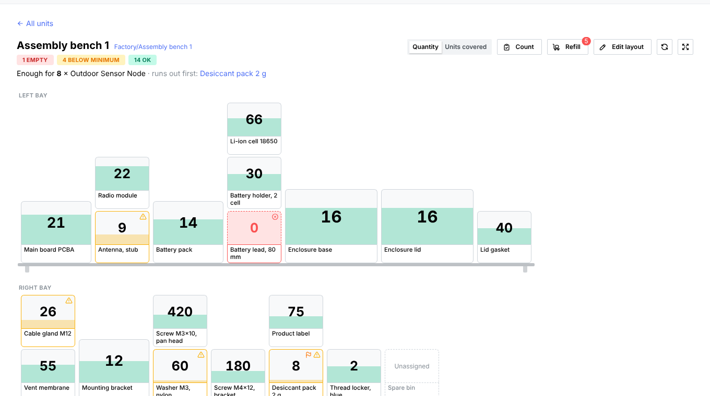
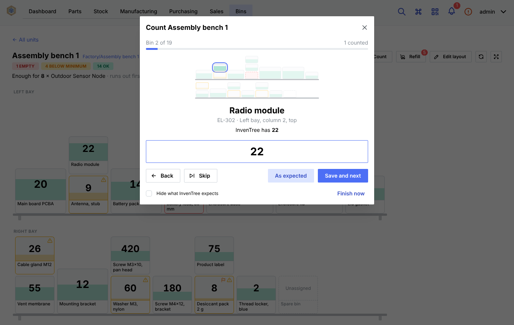
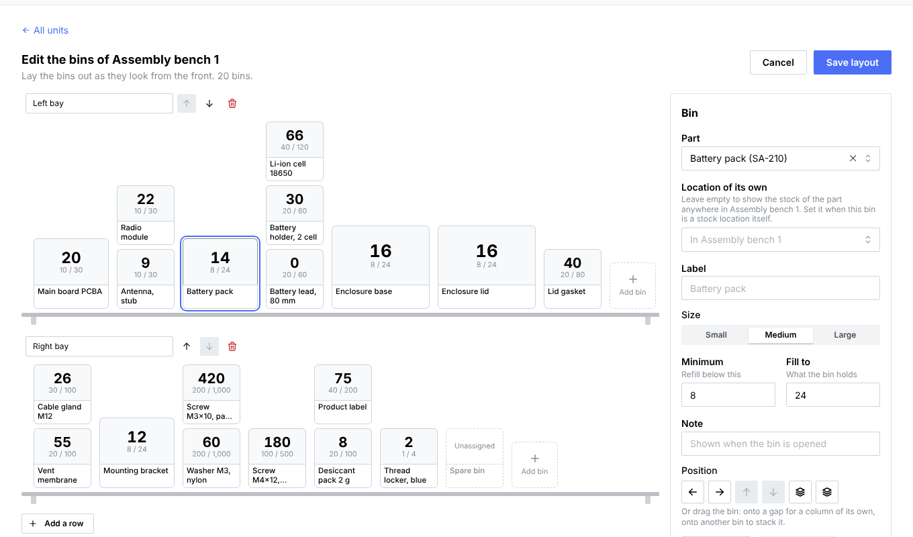
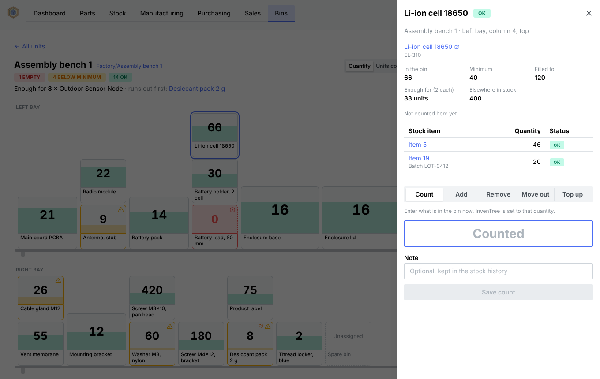
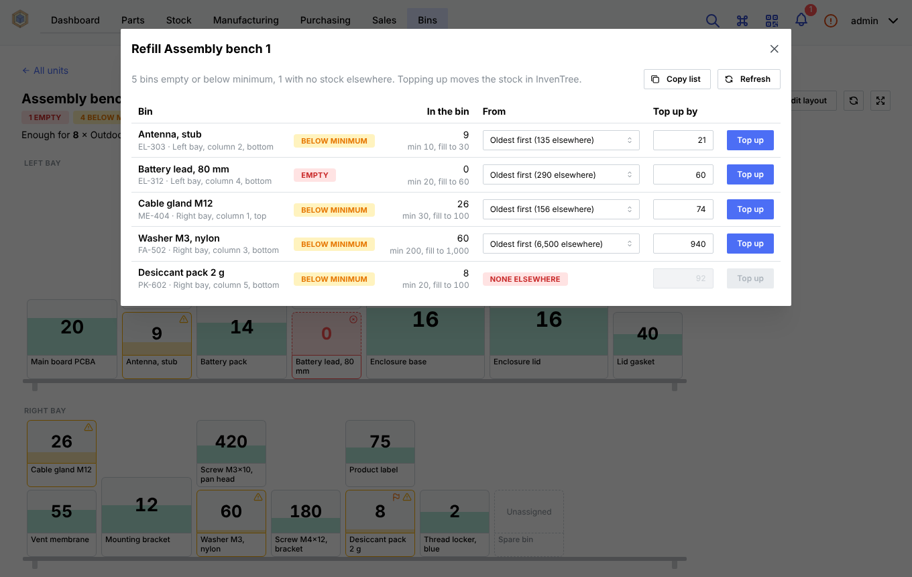
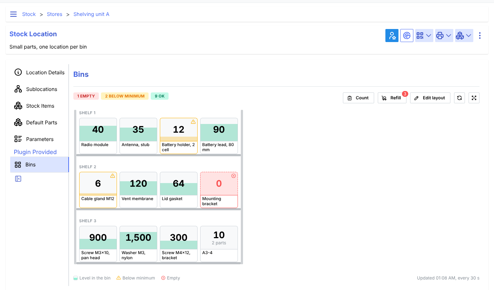
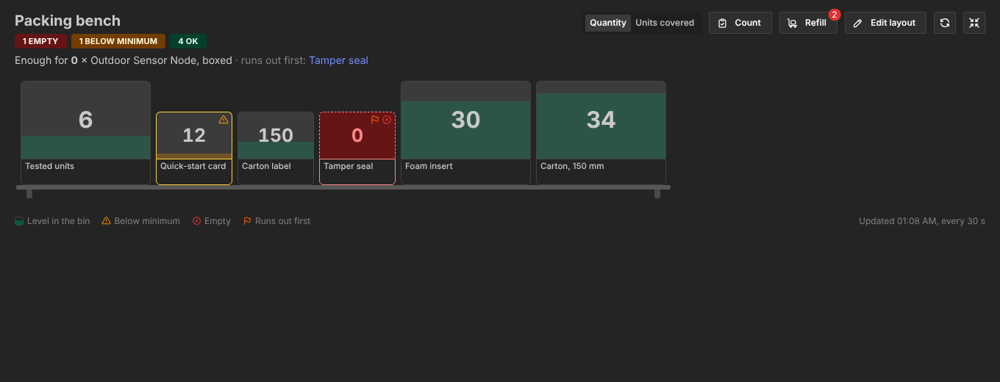

# InvenTree Virtual Bins

[](https://github.com/nemccarthy/inventree-visual-stock-bins/actions/workflows/ci.yaml)

A drawing of your bins for [InvenTree](https://inventree.org).

Lay out the bins of a workbench or a shelving unit the way they look from the
front. Each bin then shows **what is in it, how full it is and whether it
needs refilling** - and can be counted, topped up and emptied straight from
the drawing, on a desktop or on a tablet at the bench.

Built and tested against **InvenTree 1.7.3** (API 570).



| Counting bin by bin | The layout editor |
| --- | --- |
|  |  |

## What you get

- **Bins** in the main navigation bar, which opens the list of units
  (`/web/plugin/virtual-bins/units`)
- a **Bins** panel on stock location pages, with the drawing of that location
- an optional **Bins to refill** dashboard widget
- "Locate" support: pressing InvenTree's *Locate* button for a stock item or a
  location flashes its bin on any open drawing

A *unit* is a stock location whose bins have been drawn: a bench, a shelving
unit, a rack. On its drawing you can:

| | |
| --- | --- |
| **See** | The quantity in every bin, a level against what the bin holds, and which bins are empty or below their minimum |
| **Open a bin** | Its stock items, batches and statuses, when it was last counted, and how much of the part is in stock elsewhere |
| **Count, add, remove, move, top up** | Change the stock of a bin from its drawer. Everything goes through InvenTree's own stock adjustments, so it is in the stock history |
| **Count** | Walk the unit bin by bin, in the order of the layout, typing a count for each. Meant to replace a paper or spreadsheet stock sheet |
| **Refill** | A list of the bins which are due, how much each needs and where the stock is, with a button to move it |
| **Units covered** | Name the product which is built at a bench, and every bin shows how many units it is enough for - and the bench how many it can build, and which bin runs out first |
| **Full window** | For a tablet at the bench or a screen on the wall. The drawing reloads by itself |



| Units covered | The refill list |
| --- | --- |
|  |  |

| A shelving unit, on its stock location page | Full window, dark theme |
| --- | --- |
|  |  |

## How it works

### Units and bins

A unit is drawn from the front. It has **rows** (the bays of a bench, the
shelves of a shelving unit), each row has **columns**, and each column is a
**stack** of one or more bins. Bins come in three sizes.

A bin shows stock in one of three ways:

| The bin is set to | It shows |
| --- | --- |
| A **part** | The stock of that part in the location of the unit, and in every location below it. This suits a bench: one stock location, many parts, each in its bin |
| A **part** and a **location of its own** | The stock of that part in that location. This suits shelving where every bin is a stock location |
| A **location** only | Everything in that location, listed part by part. It can be looked at, but is counted in InvenTree |

A bin set to neither is a placeholder: an empty bin on the bench.

Nothing is stored about the stock itself. The quantities are read from
InvenTree every time the drawing loads, so stock which is moved, built or
received any other way shows up in its bin.

### Levels

Each bin can have a **minimum** and a level it is **filled to**.

- *Empty*: nothing in the bin.
- *Below minimum*: less than the minimum.
- The level drawn in the bin is the quantity against "fill to". A bin with
  only a minimum is drawn as if it holds twice that.
- A bin is **due a refill** when it is empty or below its minimum. It is
  topped up to "fill to", or to the minimum if there is no "fill to". A bin
  with no levels is never due.

Stock with a status which InvenTree does not treat as available (quarantined,
lost, rejected, ...) is still in the bin and is counted in its quantity; the
bin's drawer says how much of it there is.

### Changing stock

A bin can hold several stock items of the same part - two batches, or a top-up
which arrived as an item of its own - while people count and use the bin as
one quantity. The plugin spreads a change over the items:

| Action | What happens in InvenTree |
| --- | --- |
| **Count** | Every stock item in the bin is counted (a stocktake entry in its history). If the count is lower, the difference is taken from the oldest items first; if higher, it is added to the newest. A count of an empty bin creates a stock item |
| **Add** | Added to the newest stock item in the bin, or a new stock item if the bin is empty |
| **Remove** | Taken from the oldest stock items first |
| **Move out** | The quantity is moved to another location, oldest stock first |
| **Top up** | The quantity is moved into the bin from stock elsewhere: the oldest first, or a stock item you choose |

"Oldest" is the order in which the stock items were created. Stock items are
not merged, so batches stay apart. New stock goes into the bin's own location,
or into the location of the unit if the bin has none.

Bins which hold serial-numbered stock show it, but are not changed as a
quantity: open the stock items instead.

### Units covered

Give a unit a **product** (an assembly) and each bin shows how many units of
it the bin is enough for: its available stock divided by the quantity which
goes into one unit, over every level of the BOM. Consumable lines are not
counted, and neither are optional lines unless the setting says so.

The unit as a whole shows how many units **can be built** from its bins, and
which bins run out first. This number takes built sub-assemblies into account:
ten battery packs on the bench are ten units, even if the bin of cells is
empty. The rules:

- a part with a bin is taken from its bin first
- what is still missing is made from its own BOM, but only if every part on
  that BOM has a bin in the unit as well
- parts which have no bin in the unit are not the unit's concern, and never
  limit the number

### Where the data is kept

- The layout of a unit is stored in the metadata of its stock location, under
  the key `virtual_bins`. When each bin was last counted is stored beside it,
  under `virtual_bins_state`.
- "Locate" requests are kept for a few minutes in the metadata of the plugin's
  own configuration record.

The plugin has no database tables and no migrations. Removing a layout removes
both keys and leaves the location and its stock alone.

## Getting started

1. Open **Bins** in the navigation bar, choose a stock location under *Draw
   the bins of another location* and press *Set up bins* - or open the **Bins**
   panel on the page of the stock location itself.
2. Add bins. Three shortcuts make them for you:
   - *One for each part stocked here*: for a location which already holds stock
   - *One for each location below this one*: for shelving where each bin is a
     stock location
   - *From a BOM*: for a bench which is not stocked in InvenTree yet. Choose
     the assembly which is built there
3. Drag the bins into place: onto a gap for a column of its own, onto another
   bin to stack it above. Select a bin to set its part, size, minimum and
   "fill to". The arrow buttons move the selected bin without dragging.
4. Optionally choose the *Product built here*, for units covered.
5. Save. Then *Count* walks the unit once to bring InvenTree in line with what
   is really in the bins.

For a screen at the bench, open the unit and press *Full window* - or bookmark
`/web/plugin/virtual-bins/units?unit=<location id>&kiosk=1`, which opens it
that way.

## Settings

In *Admin Center → Plugins → VirtualBins*:

| Setting | Default | |
| --- | --- | --- |
| Refresh every (seconds) | 30 | How often an open drawing reloads its stock levels. 0 turns it off |
| Locate highlight (seconds) | 20 | How long a bin flashes after *Locate* is pressed |
| Show part images | on | Show the part image on medium and large bins |
| Blind counts | off | Hide the quantity InvenTree expects during a count. Can also be switched during a count |
| Count optional BOM lines | off | Include optional BOM lines in units covered |
| Show in the navigation bar | on | |
| Show on stock location pages | on | |
| Only on locations with bins | off | Show the panel only where bins have been set up. New units are then started from the Bins page |

## Permissions

| To | A user needs |
| --- | --- |
| See the drawings | *view* on Stock Items and on Stock Locations |
| Count, add, remove, move, top up | *change* on Stock Items |
| Count or add into an empty bin (which creates a stock item) | *add* on Stock Items as well |
| Set up, edit or remove a layout | *change* on Stock Locations |

People who cannot change a layout only see the **Bins** panel on locations
which have one.

## API

All endpoints are below `/plugin/virtual-bins/` and accept session or token
authentication.

| | |
| --- | --- |
| `GET units/` | Every unit, with its summary and the bins which need attention |
| `GET unit/<location>/` | The layout and the stock of every bin |
| `PUT unit/<location>/layout/` | Save a layout: `{"layout": {...}}` |
| `DELETE unit/<location>/layout/` | Remove the layout |
| `POST unit/<location>/autofill/` | Suggest a layout from `stock`, `children` or a `bom`. Nothing is saved |
| `GET unit/<location>/refill/` | The bins which are due, with where the stock is |
| `GET unit/<location>/bin/<bin>/sources/` | Stock a bin can be topped up from |
| `POST unit/<location>/bin/<bin>/adjust/` | Change the stock of a bin |
| `GET attention/` | Empty and low bins of every unit |
| `GET locate/?unit=<location>` | Bins somebody has just asked to locate |
| `GET config/` | Version, settings and the user's permissions |

A layout:

```json
{
  "kind": "bench",
  "product": 12,
  "rows": [
    {
      "name": "Left bay",
      "columns": [
        {"bins": [{"part": 31, "size": "m", "min": 10, "max": 30}]},
        {"bins": [
          {"part": 32, "min": 20, "max": 60},
          {"part": 33, "location": 8, "label": "Spares", "note": "Keep the lid on"}
        ]}
      ]
    }
  ]
}
```

`kind` is `bench` or `shelving`, `size` is `s`, `m` or `l`. The bins of a
column are listed from the top of the stack down.

Changing stock:

```json
{"action": "count", "quantity": 42}
{"action": "add", "quantity": 10}
{"action": "remove", "quantity": 4}
{"action": "move", "quantity": 4, "destination": 7}
{"action": "refill", "quantity": 50, "source": 118}
```

`destination` is a stock location, `source` an optional stock item, and every
action takes an optional `notes`. The answer says what was done and carries
the unit as it is afterwards.

## Installation

The compiled frontend is committed to this repository, so the plugin installs
straight from git - no Node tooling is needed on the server.

### 1. Install the package

Pick a git reference to install: `main` for the latest code, or a release tag
(such as `v0.1.0`) to pin a version.

**From the InvenTree web interface**

In *Admin Center → Plugins → Install Plugin*, enter:

| Field | Value |
| --- | --- |
| Package name | `inventree-virtual-bins` |
| Source URL | `git+https://github.com/nemccarthy/inventree-visual-stock-bins@main` |
| Version | leave empty |
| Confirm plugin installation | ticked |

InvenTree installs the package and adds it to `plugins.txt` for you.

**Docker, by editing `plugins.txt`**

1. Add this line to `plugins.txt` in the InvenTree data volume (the directory
   which `INVENTREE_EXT_VOLUME` points at):

   ```
   inventree-virtual-bins @ git+https://github.com/nemccarthy/inventree-visual-stock-bins@main
   ```

2. Restart the server and the worker:

   ```bash
   docker compose restart inventree-server inventree-worker
   ```

Either way, check that *Admin Center → Plugin Settings → Check plugins on
startup* is enabled. Containers install plugins into an environment which does
not survive a restart, and this setting re-installs everything in
`plugins.txt` when a container starts.

**Bare metal / virtualenv**

```bash
pip install "inventree-virtual-bins @ git+https://github.com/nemccarthy/inventree-visual-stock-bins@main"
```

then restart the InvenTree server and background worker.

**From a wheel**

Each [release](https://github.com/nemccarthy/inventree-visual-stock-bins/releases)
also has a wheel attached, for servers which cannot reach GitHub or do not
have git. Copy it into the data volume (for example `<data-volume>/wheels/`)
and put its path in `plugins.txt` instead:

```
/home/inventree/data/wheels/inventree_virtual_bins-0.1.0-py3-none-any.whl
```

### 2. Enable it

Plugin support itself must be on (`INVENTREE_PLUGINS_ENABLED=True`, which is
the default in the Docker `.env` file).

In *Admin Center → Plugin Settings*:

1. Turn on **Enable URL integration** (the drawings load their data from
   `/plugin/virtual-bins/`).
2. Turn on **Enable interface integration** (allows plugins to add pages,
   panels and navigation items).
3. In the plugin list, find **VirtualBins** and activate it.

### 3. Copy the plugin's files and restart (Docker)

On a Docker stack, finish with:

```bash
docker compose run --rm inventree-server invoke update
docker compose restart inventree-server inventree-worker
```

The plugin's JavaScript has to be copied into InvenTree's static files. When a
plugin is activated, InvenTree gives that job to the background worker, and
the worker container does not have a plugin which was installed through the
web interface - so nothing is copied. `invoke update` installs everything in
`plugins.txt` and copies the files. The restart makes every server process
pick up the plugin's URLs, and gives the worker the plugin, which "Locate"
needs.

**Bins** then appears in the navigation bar. To add the dashboard widget, open
the dashboard menu, choose *Add Widget* and pick *Bins to refill*; it takes
its full size once the page is reloaded.

### If it does not open

| What you see | Cause |
| --- | --- |
| *Page Not Found - This page does not exist* | The plugin is not active, or **Enable interface integration** is off |
| *Failed to load module: .../static/plugins/virtual-bins/VirtualBins.js* | The plugin's files have not been copied: run step 3 |
| *The Virtual Bins API was not found* | **Enable URL integration** is off, or the server has not been restarted since the plugin was activated |
| *Locate* is pressed and nothing flashes | The background worker does not have the plugin: run step 3 |

### Updating

Change the git reference (or the wheel) in `plugins.txt`, then repeat step 3.
`invoke update` is what copies the compiled frontend into InvenTree's static
files, so run it after every update.

## Limits

- **A drawing, not a floor plan.** A unit is rows of columns of stacks, seen
  from the front. There is no free placement, no photo backdrop and no top
  view.
- **Two bins of one part in the same location show the same stock.** InvenTree
  only knows the location of a stock item. To tell two bins of the same part
  apart, give each a stock location of its own. The editor flags such bins.
- **Serial-numbered stock is shown, not changed.** It is counted, moved and
  removed item by item in InvenTree.
- **Stock items are never merged.** A bin which is topped up often collects
  small stock items; merge them in InvenTree if that matters.
- **Variants are separate parts.** A bin set to a template part does not show
  the stock of its variants.
- **Units covered is a straight division**, bin by bin. Only the number for
  the unit as a whole takes sub-assemblies into account, and it looks at one
  unit at a time: two benches which share a store do not know about each
  other.
- **Stock allocated to an order is still counted** as being in the bin.
- **No phones.** InvenTree's web interface does not run on phone-sized
  screens; a tablet is the smallest that works.
- A unit can have 12 rows, 40 columns in a row, 8 bins in a stack and 400 bins
  in all. A unit of 300 bins and 900 stock items loaded in about 0.15 s on a
  development machine.

## Development

```bash
# The layout rules and the bin arithmetic are plain Python, with their own tests
pip install pytest
pytest

# The frontend (React + Mantine, built with Vite)
cd frontend
npm ci
npm run build        # writes inventree_virtual_bins/static - commit the result
```

| | |
| --- | --- |
| `inventree_virtual_bins/layout.py` | The layout, levels, counting rules and units covered. No Django or InvenTree imports |
| `inventree_virtual_bins/stock.py` | Reads the stock of a unit from InvenTree, and changes it |
| `inventree_virtual_bins/store.py` | Where layouts and "locate" requests are kept |
| `inventree_virtual_bins/views.py` | The API |
| `inventree_virtual_bins/core.py` | The plugin class: settings, URLs, interface and "locate" |
| `frontend/src/` | The drawing, the editor, the bin drawer, the count walk and the refill list |
| `dev/seed_demo.py` | Fills a throwaway InvenTree with the demo data used in the screenshots |
| `dev/test_users.py` | Makes a view-only user, an operator and a user without roles |
| `dev/integration_check.py` | Checks the plugin against the InvenTree API, on data it creates itself |

To live-reload the frontend against an InvenTree development server, add this
to InvenTree's `config.yaml` and run `npm run dev` in `frontend/`:

```yaml
plugin_dev:
  slug: 'virtual-bins'
  host: 'http://localhost:5174'
```

## Releasing

1. Set the new version in `inventree_virtual_bins/__init__.py`
   (`PLUGIN_VERSION`) and `frontend/package.json`, and add an entry to
   `CHANGELOG.md`. Make sure the committed frontend build is current (CI on
   `main` is green).
2. Commit, then tag and push:

   ```bash
   git tag v0.2.0
   git push origin main v0.2.0
   ```

The release workflow checks that the tag matches `PLUGIN_VERSION`, builds the
plugin and attaches the wheel to a GitHub release.

## License

MIT - see [LICENSE](LICENSE).
